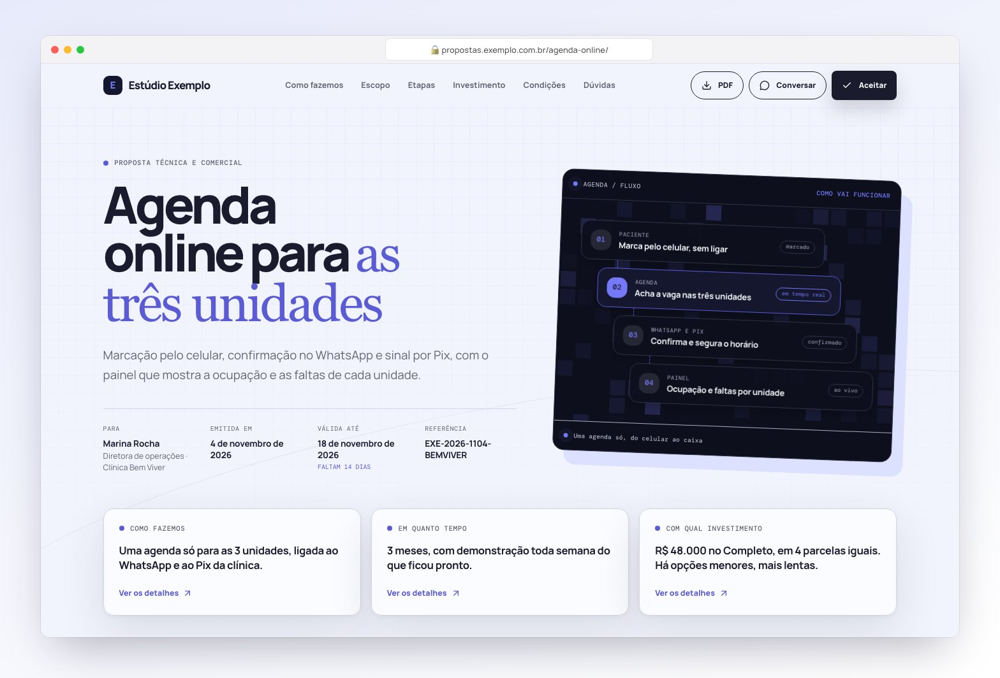
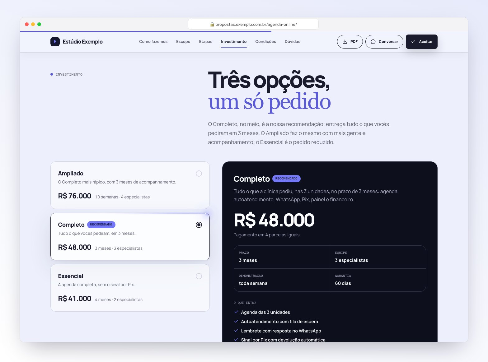
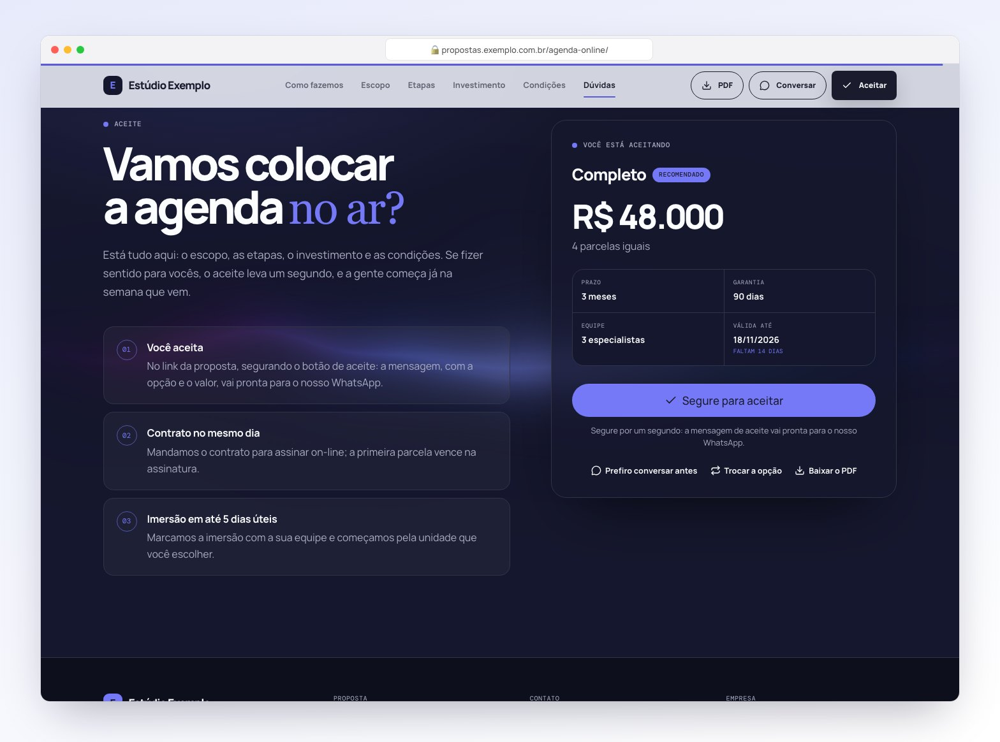
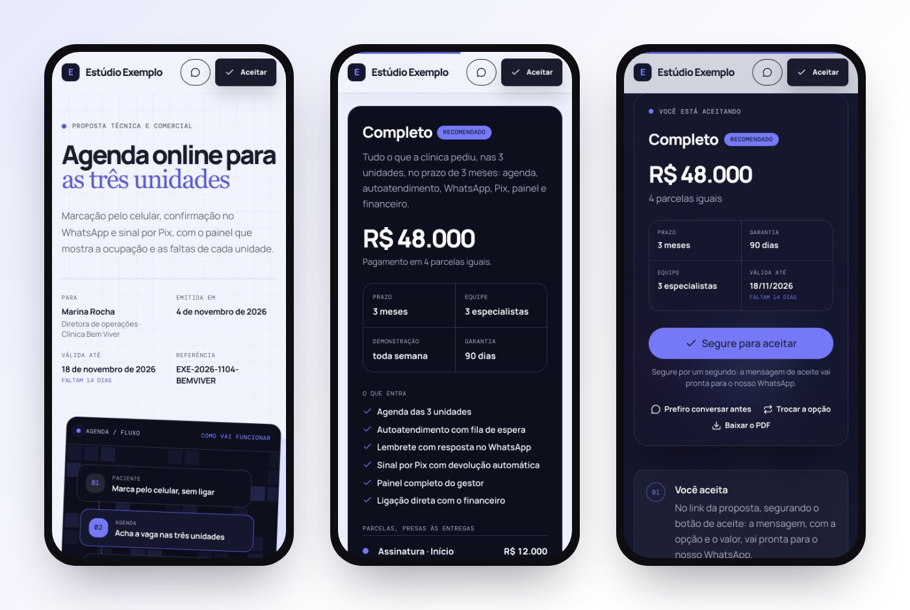
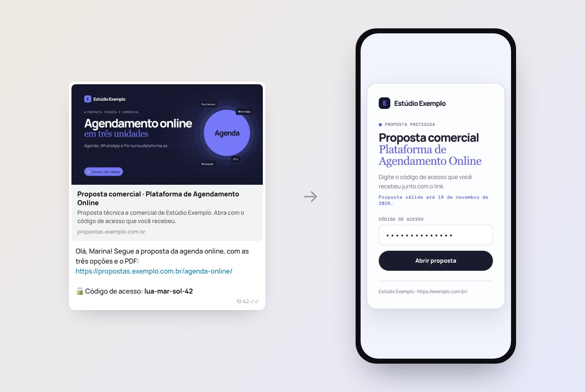
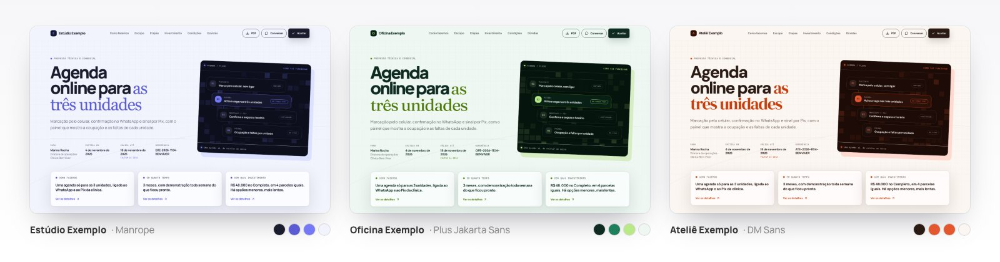

<!-- Kit de Propostas · Paulo Sérgio Dantas · github.com/dantaspaulo/kit-propostas · KPR-PSD-2026 -->
<!-- ╭──────────────────────────────────────────────────────────────╮ -->
<!-- │  Kit de Propostas · por Paulo Sérgio Dantas                  │ -->
<!-- │  github.com/dantaspaulo/kit-propostas                        │ -->
<!-- │  Licença de Uso com Atribuição v1.0 · impressão KPR-PSD-2026 │ -->
<!-- │  Imagens: ferramentas-do-repo/gerar-imagens.mjs              │ -->
<!-- ╰──────────────────────────────────────────────────────────────╯ -->

<div align="center">


<a href="#-instalar">
  
</a>

<br/>

<a href="#-instalar"></a>
<a href="#claude-code"></a>
<a href="#codex-cursor-gemini-e-outros"></a>
<a href="#-publicar-com-c%C3%B3digo-de-acesso"></a>

<a href="https://github.com/dantaspaulo/kit-propostas/actions/workflows/conferir.yml"></a>
<a href="https://github.com/dantaspaulo/kit-propostas/releases/latest"></a>
<a href="LICENSE"></a>


<br/><br/>

**Você conta o que o cliente pediu. A sua IA devolve uma proposta bonita, com a sua marca,<br/>o escopo inteiro item por item, o preço bem apresentado, o PDF e o link pronto para o WhatsApp.**

<sub>Um kit de skills para o Claude Code e outros agentes. Na primeira vez, uma entrevista lê o seu site e aprende o seu negócio, as suas cores, as suas fontes e o seu logo. Depois disso, cada proposta sai com a sua cara e vai para o ar na Cloudflare, protegida por um código de acesso.</sub>

<br/><br/>



<sub>Proposta de exemplo: o negócio (Estúdio Exemplo) e o cliente (Clínica Bem Viver) são inventados.</sub>

</div>

<br/>

## 🧭 Como funciona

```text
 1. Entrevista        uma vez só: o nome do negócio e o site. O kit lê o site e monta a sua marca e a memória do negócio.
 2. Pedido            você cola a mensagem, o áudio transcrito ou as anotações da reunião com o cliente.
 3. Proposta          a IA monta a página: escopo preso ao pedido, opções, etapas, custos, condições e dúvidas.
 4. Conferência       o kit recusa a página se a conta não fecha, se sobrou nome de outro cliente ou se falta item do pedido.
 5. PDF e prévia      o PDF sai igual à tela, e a imagem da prévia do link fica pronta para o WhatsApp.
 6. No ar             a página sobe para a Cloudflare, atrás de um código de acesso gerado na hora.
 7. Mensagem          a IA escreve a mensagem para o cliente, com o link e o código.
```

Você decide o que só você sabe: valores, prazos e o que entra. O resto a IA propõe e diz que é sugestão.

<br/>

## 🖼️ Como fica

<div align="center">



<sub><b>Investimento com âncora.</b> A opção maior aparece primeiro e segura a referência de preço; a recomendada vem escolhida, com tudo o que entra, as parcelas e a garantia.</sub>

<br/><br/>



<sub><b>Da leitura ao aceite.</b> O fim da página é um aceite, não um "fale com a gente": o que acontece depois do sim, o resumo da opção e o botão de segurar para aceitar, que abre o WhatsApp com a opção, o valor e o pagamento já escritos.</sub>

<br/><br/>



<sub><b>No celular.</b> Tudo cabe na tela: o investimento abre direto na recomendada, e o aceite vem logo abaixo do título, com o valor e o botão.</sub>

<br/><br/>



<sub><b>O link e o código.</b> A prévia no WhatsApp mostra o projeto sem expor valores nem o nome do cliente. A página só abre com o código.</sub>

<br/><br/>



<sub><b>Com a sua marca.</b> A mesma proposta em três negócios inventados: cores, fontes e nome saem do perfil que a entrevista montou, com contraste conferido.</sub>

</div>

<br/>

## 💰 Três jeitos de mostrar o valor

Cada proposta escolhe um modo. A IA pergunta qual, se você não disser.

| Modo | Quando usar | O que o cliente vê |
|---|---|---|
| **Âncora abaixo** | O cliente ainda não sabe quanto custa. | 2 ou 3 opções. A recomendada é o pedido inteiro e vem primeiro; as outras são versões reduzidas, mais baratas e mais lentas. |
| **Âncora acima** | Você quer que o preço pareça justo perto de uma opção maior. | 3 opções. A maior ancora no topo, a recomendada fica no meio e já vem escolhida, e a menor custa perto dela, mas entrega bem menos. |
| **Direto** | O valor já foi combinado com o cliente. | Uma opção só, com o valor combinado, sem a palavra "opção" e sem preço por módulo. |

O kit confere a âncora antes de deixar a página sair: a recomendada no lugar certo, a soma dos módulos igual ao total, as parcelas fechando o valor e os prazos batendo com as etapas.

<br/>

## 🚀 Instalar

Precisa de macOS ou Linux (no Windows, pelo WSL), [Node 20 ou mais novo](https://nodejs.org) e git.

### Claude Code

No terminal:

```bash
curl -fsSL https://raw.githubusercontent.com/dantaspaulo/kit-propostas/main/instalar.sh | bash
```

O instalador põe as duas skills em `~/.claude/skills`, prepara as ferramentas em `~/.kit-propostas` e baixa um navegador sem tela (cerca de 200 MB, uma vez só) para o PDF e as capturas. No fim, ele oferece começar a entrevista.

**Ou como plugin**, dentro do Claude Code:

```text
/plugin marketplace add dantaspaulo/kit-propostas
/plugin install kit-propostas@kit-propostas
```

### Peça para a sua IA

Cole isto no Claude Code (ou em outro agente que rode comandos no seu computador):

```text
Instale o Kit de Propostas do github.com/dantaspaulo/kit-propostas seguindo o AGENTS.md
de lá e depois comece a entrevista de personalização comigo.
```

### Codex, Cursor, Gemini e outros

O kit segue o formato aberto de skills. Para instalar em `~/.agents/skills`, a pasta que Codex, Cursor, GitHub Copilot, Gemini CLI, Windsurf e OpenCode leem:

```bash
curl -fsSL https://raw.githubusercontent.com/dantaspaulo/kit-propostas/main/instalar.sh | bash -s -- --agente agents
```

Para os dois lugares, `--agente todos`. O passo a passo para a IA está no [AGENTS.md](AGENTS.md).

<sub>Atualizar: rode o instalador de novo. O que mudou em cada versão: [Releases](https://github.com/dantaspaulo/kit-propostas/releases) e [CHANGELOG.md](CHANGELOG.md). Desinstalar: `~/.kit-propostas/kit/desinstalar.sh` (tira as skills e não apaga as suas propostas).</sub>

<br/>

## 🎙️ A entrevista

Na primeira vez, diga **"vamos configurar o kit de propostas"** (ou `/propostas-configurar`). A IA pergunta o nome do negócio e o site, e o kit lê o site sozinho:

- **as cores**, pesadas pelo uso (fundo, texto, botões), e monta a paleta com contraste de leitura conferido;
- **as fontes** do Google Fonts que o site usa;
- **o logo**, inclusive o que é feito de texto: os candidatos vêm do mais provável para o menos, e a faixa de logos de clientes fica de fora;
- **o que o negócio faz**, os contatos e até quatro páginas internas (sobre, serviços, produtos, cases, contato).

Depois ela confirma com você o que entendeu, pergunta o que o site não diz (validade, pagamento, garantia, nota fiscal) e mostra uma prévia da marca no navegador. No fim, grava o perfil e a **memória do negócio** em `~/Propostas/meu-negocio`. No Claude Code, essa memória passa a valer em toda conversa, e você desliga quando quiser.

<br/>

## ✍️ Fazer uma proposta

Diga algo como:

```text
Faz uma proposta para a Clínica Bem Viver. Eles pediram isto: <cole o pedido>.
Já combinei 42 mil com eles, em 3 vezes.
```

A IA monta o pedido item por item, propõe o escopo, as etapas e as condições, e só segue para os valores com o seu ok. Antes de publicar, você vê as capturas no computador e no celular e o PDF.

O que a página traz: o topo com o caminho da solução num cartão e o resumo em três respostas (como, em quanto tempo, com qual investimento), a solução, o escopo item por item com o que entra em cada opção, as etapas com as entregas, o investimento, os custos que ficam com o cliente (hospedagem, mensagens, taxas), as condições (aceite, garantia, o que não está incluso, propriedade), as dúvidas e o aceite. Uma barra acompanha quem passou do investimento e continuou lendo, para o aceite estar sempre a um toque.

<br/>

## 🔒 Publicar com código de acesso

As propostas moram num Worker da Cloudflare, no seu nome. O plano gratuito dá conta: são 100 mil acessos por dia.

1. **Uma vez:** crie a conta grátis em [cloudflare.com](https://dash.cloudflare.com/sign-up) e faça o login pelo terminal. No Claude Code, digite `! npx wrangler@4 login` e confirme no navegador.
2. **Endereço:** de início, `propostas-<sua-sigla>.<sua-conta>.workers.dev`. Com um domínio seu na Cloudflare, fica `propostas.seunegocio.com.br`.
3. **Cada proposta:** o kit gera um código aleatório (como `lua-mar-sol-42`), mostra uma vez só e nunca grava em arquivo. A Cloudflare guarda só a impressão digital dele (SHA-256).

O que o cliente vê: a prévia do link no WhatsApp (sem valores e sem o nome dele), a tela com o seu logo pedindo o código e, com o código certo, a proposta e o PDF. O acesso vale 30 dias naquele aparelho, só para aquela proposta.

<br/>

## 🛡️ Segurança e privacidade

- **Código de acesso:** aleatório, comparado sem diferenciar maiúsculas e espaços, nunca salvo. O cookie de acesso é assinado com um segredo que só a Cloudflare tem e fica preso ao endereço de cada proposta.
- **Tentativas:** código errado espera 0,7 s. O limite é de 10 tentativas por minuto por endereço (no IPv6, o bloco inteiro) e de 30 por proposta, somando todos os endereços. O código sorteado tem cerca de 926 milhões de combinações.
- **Fora da busca:** `noindex`, `robots.txt` fechando tudo, CSP e nada em cache público. Só a imagem da prévia e o logo são públicos.
- **Testado no runtime de verdade:** 32 testes da lógica do portão e 22 rodando no `wrangler dev`, o mesmo motor da Cloudflare, sem enviar nada.
- **Nada some e nada vaza:** o build recusa a página se sobrou nome, endereço ou referência de outra proposta, se o texto público cita o cliente ou valores, e se a chave do React Bits Pro aparecer.
- **Seus dados ficam com você:** o kit não tem telemetria. Fora os downloads (GitHub, npm, o navegador e os componentes gratuitos do React Bits), ele só fala com o seu site (quando você pede a leitura), com o Google Fonts (as fontes da página) e com a Cloudflare (quando você publica). Detalhes em [PRIVACIDADE.md](PRIVACIDADE.md).

<br/>

## ✨ Animações do React Bits

As seções do modelo são código próprio sobre [shadcn/ui](https://ui.shadcn.com) (Radix e Tailwind), com animações em Motion, e quatro peças vêm do [React Bits](https://reactbits.dev) gratuito: a esfera viva da solução (Orb), a estrela que percorre a opção recomendada (StarBorder), o botão de segurar para aceitar (HoldButton) e a aurora do aceite (SoftAurora).

A licença do React Bits deixa usar em qualquer site, inclusive comercial, mas não deixa redistribuir os componentes. Por isso o código deles não está neste repositório: quando uma proposta nasce, o kit baixa os quatro do registro oficial para a sua máquina, como uma biblioteca.

Se você tem licença do [React Bits Pro](https://pro.reactbits.dev), a skill também troca seções por blocos pagos, com a **sua** chave (`REACTBITS_LICENSE_KEY`), e indica qual bloco combina com cada seção. Nada disso vem no repositório, e a sua proposta continua sendo uma página só, no seu Worker.

<br/>

## 🗂️ O que tem aqui

```text
skills/
  propostas/                 a skill que faz, ajusta e publica propostas
    SKILL.md                   o roteiro, as regras e a conferência final
    referencias/               método, design, código, publicação, mensagens e lições aprendidas
    modelo/                    a página (React, Tailwind, shadcn/ui, Motion), o build com as guardas, PDF e prévia
    publicacao/                o portão (Worker), o código de acesso, a publicação e os testes
    ferramentas/               ambiente, espaço de trabalho, proposta nova, paleta e marca
  propostas-configurar/      a entrevista: lê o site, monta o perfil, a prévia da marca e a memória
instalar.sh · desinstalar.sh   instalam e tiram as skills (nunca apagam as suas propostas)
AGENTS.md                      o passo a passo para outras IAs
testes/                        bateria leve, completa e o portão no runtime da Cloudflare
```

<br/>

## 🧪 Testes

```bash
bash testes/testar.sh                # leves: sintaxe, portão, paleta e a trava do repositório
bash testes/testar.sh --completo     # também compila o modelo nos três modos e prova 9 recusas do build
bash testes/portao-no-runtime.sh     # o portão no wrangler dev, com uma proposta inventada
```

<br/>

<div align="center">

## 📜 Licença e autoria

</div>

O **Kit de Propostas** foi criado por **Paulo Sérgio Dantas** e é distribuído gratuitamente pela [Licença de Uso com Atribuição v1.0](LICENSE):

- ✅ **Pode:** usar de graça, inclusive comercialmente; fazer quantas propostas quiser, para quantos clientes quiser; modificar para uso próprio; divulgar o link.
- ✅ **As propostas são suas:** a página que o kit gera não precisa de crédito nenhum.
- ✅ **Pode redistribuir**, só de graça, mantendo os avisos de autoria, com crédito visível e as mudanças indicadas.
- ❌ **Não pode:** vender o kit ou uma versão dele, apagar ou trocar os créditos, ou apresentar como seu.

Os créditos são protegidos de quatro formas: uma linha de crédito em cada arquivo; o manifesto `AUTORIA.json`, com a impressão digital de cada arquivo da versão oficial; a impressão `KPR-PSD-2026`; e uma **trava**: o instalador, a abertura de proposta, a entrevista, o build e a publicação se recusam a funcionar com os créditos trocados ou retirados.

Detalhes em [NOTICE.md](NOTICE.md). Componentes de terceiros e as licenças deles em [THIRD-PARTY.md](THIRD-PARTY.md).

```text
Kit de Propostas, de Paulo Sérgio Dantas · github.com/dantaspaulo/kit-propostas
```

<br/>

<div align="center">

## 📫 Quem fez

**Paulo Sérgio Dantas**: empresário, Forward Deployed Engineer e advogado. Construo negócios com IA, do diagnóstico ao resultado medido.

<sub>Viu uma cópia sem crédito ou sendo vendida? Me avise: a versão oficial é gratuita e fica só aqui.</sub>

<br/>

<a href="https://github.com/dantaspaulo"></a>
<a href="https://paulosdantas.adv.br"></a>
<a href="https://www.linkedin.com/in/paulosdantas/"></a>
<a href="mailto:contato@paulosdantas.adv.br"></a>

<br/><br/>

<sub>⭐ Se o kit te ajudou a fechar um projeto, deixe uma estrela: ajuda outras pessoas a acharem a versão oficial.</sub>

</div>

<div align="center">

</div>
